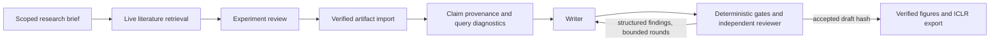

# final system design and resource scope

## Native Team execution

Cross-stage context lives in durable workflow artifacts, not an ever-growing
conversation. The leader performs topic framing and claim compilation in a
scoped native Team. Experiment planning, writing, review and revision use
named specialist personas through one native openJiuwen model invocation per
attempt, with the same validated handoff schema and scientific stage prompts.
This hybrid route preserves stage separation and provenance checks while
avoiding the native Team task-board polling seen in the failed run. It does
not claim native Team delegation for those direct specialist stages.

The failed `topic_intake` run submitted a 6,919-byte query but received 168,364
input tokens across five native Team provider calls, reaching 173,706 total
tokens and the 150,000-token stage guard. Post-enrichment inspection found 15
generic tools and 20 generic rails on each member. The `prompt_only` profile
now removes those general-purpose capabilities *after* JiuwenSwarm enrichment;
the core Team configurator still injects native task and handoff rails. Research
retrieval, experimentation and evidence validation remain in the deterministic
workflow. The first `prompt_only` retry reduced input tokens per provider call
but still exhausted eight topic calls: the leader spent several calls creating
and polling a delegated task, then returned a waiting notice before a structured
result arrived. Topic framing is now leader-owned; the independent literature
research stage still retrieves evidence. The profile also disables image
modality probes, which can make extra provider requests outside the stage
receipt stream. These are implementation changes, not a measured successful-
paper cost reduction. The next retry completed topic framing in one provider
call and then literature retrieval, but experiment planning exhausted ten
provider calls (171,767 tokens) on task-board coordination. Direct specialist
routing now applies to all four specialist-owned stages; completed checkpoints
are retained on resume.

The compact handoff removes unrelated personas and JSON indentation; it does
not truncate evidence, manuscripts, citations, reviewer findings or numbers.
`team_prompt_audit.jsonl` records submitted UTF-8 byte length and SHA-256, never
prompt content. Byte reduction is not a provider-token or cost estimate.

## Limits and failure behavior

`team.stage_resource_limits` can tighten global invocation ceilings for observed
provider calls, observed tokens and submitted prompt bytes. Invalid limits fail
closed. An oversized prompt is rejected before native Team construction; the
evidence is not silently shortened. Stream ceilings stop the Team once observed
receipts reach the cap. In-flight calls may overshoot; missing receipts cannot
support an enforceable token guarantee. Whole-run accounting survives resume.

HTTP 401/402/403/404 failures, timeouts and budget exhaustion preserve diagnostics
and available receipts. Fatal provider failures are not repeatedly retried.
Checkpoints avoid recomputing completed scientific stages on resume. The launcher
accepts only a failed/interrupted real Team run with identical scientific and
model inputs. It permits narrowly defined runtime recovery (the `prompt_only`
profile, the exact direct-specialist recovery route, or increases in existing
ceilings), audits those changes, and snapshots
the old config, receipts, logs and database before changing the run. A failed
stage writes a partial resource report from durable observed receipts. Lasttwo
cannot accidentally become a final run.

The launcher checks dependencies, exact native Team schema/assembly, direct
model construction, figure
inputs and TeX packages before paid calls; a separate read-only progress watcher
reports checkpoint state every 30 seconds. It labels token totals as durable
completed-stage receipts, which exclude work still in flight.

The latest real run reached a complete revised manuscript but stopped at the
global 12-request ceiling before another revision. Its last paid review binds
the saved draft SHA-256. Nine purported quality defects came from parser
false positives: adjacent captions after short image labels, italic Table
captions, the verified `fiqa_lexical` dataset key, and standard floor math.
After correcting these checks, the unchanged draft passes both deterministic
quality and scientific consistency gates offline. The revalidation path for
such a partially completed loop requires the hash-bound paid review, excludes
independent reviewer defects, preserves original evidence including a
WAL-consistent database snapshot, and records zero new model calls. The PDF
export remains a separate user-run step.

## What has and has not been measured

The offline stage-policy benchmark compares broad and compact envelopes around
identical current stage content. Native schema validation, injected-failure
tests, complete-payload equality and scope checks are local measurements. They
are not model-generated papers or live quality/cost comparisons.

The historical lasttwo run observed 6,158,640 tokens across 81 provider receipts
and 12 workflow invocations. Those are historical observations, not final usage.
Final's lower limits are guards, not a claimed savings percentage. A matched live
comparison should use the same provider/model, dataset artifacts, literature
snapshot, revision policy and task, with separate output directories. Report
successful-paper quality, receipts, tokens, elapsed time and failures together.
The final competition paper must receive its own official review token.

## Framework contribution

Reusable additions live under `jiuwenswarm/agents/harness/research/`:
native stage contracts, stage roster policy, validated resource ceilings,
hash-only prompt telemetry, provenance/context/consistency rails, durable run
store, provider diagnostics and receipt accounting. Experiment-specific
definitions/plots stay in the SciTrace example. Tests use provider-shaped streams
without charged network calls. The cumulative patch includes previous framework
work and final changes; it is not a patch containing only this round.
